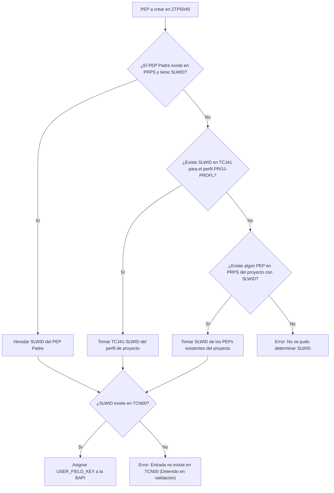

# Transacción SAP GUI ZTPS045: Creación Masiva de Elementos PEP (WBS)

Repositorio corporativo para el desarrollo en **SAP ECC / SAP S/4HANA** del módulo **SAP PS (Project System)** correspondiente a la transacción personalizada **ZTPS045** (Report principal `ZPS_R_00056`).

* **Módulo SAP:** PS - Sistema de Proyectos (*Project System*)
* **Transacción:** `ZTPS045`
* **Programa Principal:** `ZPS_R_00056`
* **Autores Originales:** `ZZMROMEO` & `ZZDPARGA`
* **Objeto de Log BAL (SLG1):** `ZTPS045` / Subobjeto: `CARGA_PEP`
* **Última Incidencia Resuelta:** **ServiceDesk SD 1134992** (Corrección determinación clave de campos de usuario `SLWID` / `TCN00`)

---

## 📁 Estructura del Repositorio

El código fuente está modularizado en su programa principal y sus correspondientes *includes* bajo la carpeta `src/`, compatible con **abapGit**:

```
sap-ps-gui-ztps045/
├── src/
│   ├── zps_r_00056.prog.abap       <-- Report principal y orquestador START-OF-SELECTION (Background/Foreground)
│   ├── zps_r_00056_top.prog.abap   <-- Declaración de datos globales, constantes, tipos y estructuras
│   ├── zps_r_00056_sel.prog.abap   <-- Pantalla de selección (p_file, p_back) y eventos de usuario
│   ├── zps_r_00056_log.prog.abap   <-- Gestión de Application Log (BAL / SLG1)
│   ├── zps_r_00056_util.prog.abap  <-- Rutinas auxiliares, jerarquías y validación de máscaras (TCJED)
│   ├── zps_r_00056_excel.prog.abap <-- Parser de ficheros .xlsx (CL_FDT_XL_SPREADSHEET) y descarga de plantilla OLE
│   ├── zps_r_00056_val.prog.abap   <-- Validaciones de negocio, coherencia jerárquica y determinación de SLWID
│   ├── zps_r_00056_bapi.prog.abap  <-- Construcción de estructuras y llamadas a BAPI_BUS2054_CREATE_MULTI
│   └── zps_r_00056_f01.prog.abap   <-- Flujo principal, preparación de background jobs y balanceo de lotes
├── .gitignore
└── README.md
```

---

## 🎯 Funcionalidad y Características

1. **Carga Masiva desde Fichero Excel (`.xlsx`):**
   * Lectura de fichero mediante la clase estándar de SAP `CL_FDT_XL_SPREADSHEET` (vía `GUI_UPLOAD` en diálogo o `OPEN DATASET` en fondo).
   * Generación y descarga interactiva de la plantilla Excel oficial con formateo automático, estilos y hoja de leyenda mediante automatización OLE.
2. **Validación Exhaustiva de Entrada:**
   * Comprobación de formato de máscaras de edición PEP según parametrización en tabla `TCJED` (`CONVERSION_EXIT_ABPSN_INPUT`).
   * Normalización de IDs de proyecto, conversión alpha de responsables/solicitantes y verificación contra la tabla `TCJ04`.
   * Comprobación multinivel de existencia y coherencia de elementos padre tanto en el sistema SAP (`PRPS`) como en el propio fichero de carga.
   * Detección de duplicados internos (en el fichero) y existentes en base de datos.
3. **Modos de Ejecución:**
   * **Foreground (Diálogo):** Carga inmediata con presentación automática del Application Log en pantalla para volúmenes estándar.
   * **Background (Fondo):** Transferencia automática previa del fichero local al servidor de aplicaciones (vía `C_SAPGPARAM`: `DIR_GLOBAL` / `DIR_TEMP`) y lanzamiento del job desasistido `ZJOB_PEPS_<UNAME>` sin riesgo de pérdida de datos.
4. **Resiliencia Transaccional:**
   * Procesamiento aislado mediante BAPI oficial `BAPI_BUS2054_CREATE_MULTI`.
   * Ejecución controlada de dos fases con `BAPI_PS_PRECOMMIT` y `BAPI_TRANSACTION_COMMIT / ROLLBACK`.
   * Algoritmo de división dicotómica (*split*) para lotes y aislamiento individual (`gc_forzar_individual = abap_true`) para eludir la incidencia estándar `CNIF_PI054`.

---

## 🛠️ Resolución de Incidencias

### Incidencia ServiceDesk SD 1134992: Error en ZTPS045

#### 1. Descripción de la Incidencia
* **Proyecto afectado:** `AQ.8384` (en concreto la rama `AQ.8384.K.B`).
* **Síntoma reportado:** El programa asignaba la clave de campo `ZQN0001` cuando la clave de campo de usuario del proyecto/rama era `ZQPCQ01`.
* **Mensaje de error SAP:** `"Entrada ZQN0001 no existe en TCN00"`.

#### 2. Diagnóstico y Causa Raíz
En el include de validaciones `ZPS_R_00056_VAL`, el programa asignaba directamente el perfil de proyecto (`PROJ-PROFL`) al campo de la BAPI `user_field_key`:
```abap
<ls_data>-user_field_key = ls_proj_info-profl.
```
* En SAP PS, `PROFL` es el **Perfil de Proyecto** (tabla `PROJ` / `TCJ41`). En el proyecto `AQ.8384`, `PROFL = 'ZQN0001'`.
* La **Clave de Campos de Usuario** (`USER_FIELD_KEY` / `PRPS-SLWID`) se verifica contra la tabla de customizing `TCN00`.
* `ZQN0001` es un código de perfil de proyecto en `TCJ41`, por lo que **no existe en `TCN00`**. La clave real parametrizada para los elementos PEP de ese proyecto es `ZQPCQ01`.

#### 3. Solución Implementada
Se implementó un mecanismo de determinación jerárquica robusto y conforme al estándar SAP PS en `ZPS_R_00056_TOP` y `ZPS_R_00056_VAL`:



1. **Herencia Jerárquica:** Si el PEP padre ya existe en `PRPS`, hereda su `SLWID`, asegurando que todas las ramas del proyecto conserven su misma clave de campos.
2. **Derivación de Perfil (`TCJ41`):** Si el padre es nuevo o no tiene clave, se consulta la clave de campos propuesta por defecto en `TCJ41-SLWID` asociada al perfil `PROJ-PROFL`.
3. **Respaldo en Proyecto:** Si `TCJ41` no tuviera clave, se busca en `PRPS` de otros elementos del mismo proyecto (`PSPHI`).
4. **Validación Previa en `TCN00`:** Se comprueba la existencia de la clave en `TCN00` antes de invocar la BAPI, registrando errores claros en el Application Log en caso de inconsistencia en el customizing.

---

## 📋 Requisitos e Instalación

* **Entorno:** SAP NetWeaver AS ABAP 7.40 o superior / SAP S/4HANA.
* **Objeto Application Log:** Objeto `ZTPS045`, Subobjeto `CARGA_PEP` (transacción `SLG0`).
* **Clase de Desarrollo / Paquete:** Paquete corporativo de PS (ej. `ZPS`).
* **Instalación con abapGit:** Clonar este repositorio directamente sobre el paquete correspondiente en SAP.
